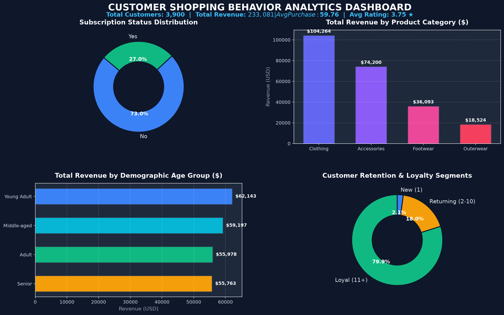
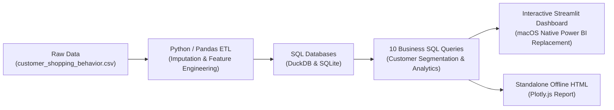

# 🛍️ Customer Shopping Behavior Analytics — Portfolio Project

[](https://www.python.org/)
[](https://duckdb.org/)
[](https://streamlit.io/)
[](https://plotly.com/)
[](https://opensource.org/licenses/MIT)

> An industry-standard, end-to-end retail data analytics project translating **3,900 customer purchases across 50 US states** into strategic business intelligence, customer loyalty segmentation, and revenue optimization.

---

## 📊 Interactive Dashboard Overview



---

## 📌 Executive Summary & Business Problem

Retail organizations face fierce competition and rising customer acquisition costs. Maximizing Customer Lifetime Value (CLV) requires actionable visibility into:
1. **Customer Segmentation & Loyalty:** Identifying high-value repeat shoppers vs. churn risks.
2. **Subscription Monetization:** Uncovering why repeat buyers haven't subscribed and converting them.
3. **Discount Sensitivity vs. Margin Protection:** Dissecting whether discounts dilute margins or drive high-ticket sales.
4. **Logistics & Spend Impact:** Measuring how shipping speeds correlate with cart size.

This project delivers an **end-to-end corporate workflow** answering 10 critical business questions using **Python, SQL, and interactive web visualization**.

---

## 🏗️ Architecture & Technical Workflow



1. **Data Cleaning & Wrangling (Python / Pandas):**
   - Imputed 37 missing values in `Review Rating` using product category medians.
   - Standardized columns to snake_case (`purchase_amount_(usd)` $\rightarrow$ `purchase_amount`).
   - Engineered demographic brackets (`Young Adult`, `Adult`, `Middle-aged`, `Senior`) using `pd.qcut()`.
   - Engineered `purchase_frequency_days` and dropped redundant promo code fields.

2. **Database Integration & SQL Analytics (DuckDB & SQLite):**
   - Exported cleaned data to local **SQLite** (`customer_behavior.db`) and **DuckDB** (`customer_behavior.duckdb`).
   - Directly executes PostgreSQL dialect queries (`::numeric` casting and `ROW_NUMBER() OVER (...)` window functions) with zero external database server overhead.

3. **Mac-Native Power BI Alternative (Streamlit & Plotly):**
   - Microsoft Power BI Desktop is exclusively built for Windows. To ensure full native functionality on macOS and Linux, an interactive web dashboard was built in **Streamlit & Plotly** matching the Power BI report layout, slicers, KPI metric cards, and adding a **live interactive SQL playground**.

---

## 💡 Key Analytical Findings (The 10 Business Questions)

| # | Business Question | SQL Focus | Key Finding & Strategic Impact |
|---|---|---|---|
| **Q1** | **Revenue by Gender** | `SUM()`, `GROUP BY` | **Male shoppers generate \$157,890 (67.7%)** vs. **\$75,191 (32.3%)** for female shoppers. Target male shopper marketing while optimizing female apparel acquisition. |
| **Q2** | **High-Spending Discount Users** | Subqueries, `AVG()` | **839 shoppers** used discounts and still spent above average, averaging **\$79.79** per order (generating \$66.9K total). Establish minimum spend thresholds (e.g., *"\$15 off \$80+"*) to protect margins. |
| **Q3** | **Top 5 Rated Products** | `AVG()`, `LIMIT` | **Gloves (3.86★)**, **Sandals (3.84★)**, **Boots (3.82★)**, **Hat (3.80★)**, and **Skirt (3.78★)** hold the highest customer satisfaction scores. |
| **Q4** | **Shipping Spend Comparison** | `IN()`, `ROUND()` | **Express shipping** buyers spent **\$60.48** avg vs **\$58.46** for Standard (~3.5% premium). Offer express shipping upgrades for orders reaching \$75+ to incentivize cart expansion. |
| **Q5** | **Subscribers vs. Non-Subscribers** | `COUNT()`, `SUM()` | Subscribers make up **27% of customers (1,053)** generating \$62.6K revenue. Average spend is virtually identical (\$59.49 vs \$59.87), proving subscriptions boost frequency over basket size. |
| **Q6** | **Top 5 Discounted Products** | `CASE WHEN`, `% Ratio` | **Hats (50.0%)**, **Sneakers (49.7%)**, and **Coats (49.1%)** see half of all orders discount-driven. |
| **Q7** | **Customer Segmentation** | CTE, `CASE WHEN` | **79.9% (3,116)** of customers are classified as **Loyal** (11+ purchases), **18.0% (701)** as **Returning**, and **2.1% (83)** as **New**. Retention is exceptionally strong. |
| **Q8** | **Top 3 Products Per Category** | Window `ROW_NUMBER()` | Category top sellers: **Blouse & Pants** in Clothing (171 each), **Jewelry** in Accessories (171), **Jacket** in Outerwear (163), and **Sandals** in Footwear (160). |
| **Q9** | **Repeat Buyers Subscription Upsell** | Window functions | **72.4% (2,518) of repeat buyers (>5 purchases) are NOT subscribed**. This represents the single highest-ROI organic conversion opportunity. |
| **Q10**| **Revenue Contribution by Age** | Demographic Aggregation | **Young Adults** lead total spend with **\$62.1K (26.7%)**, followed by **Middle-aged** (\$59.2K / 25.4%), **Adults** (\$56.0K), and **Seniors** (\$55.8K). |

---

## 🎯 Strategic Business Recommendations

1. **Targeted Subscription Conversion Campaign:**
   - Launch a personalized email / checkout campaign aimed at the **2,518 non-subscribed repeat buyers**, offering an annual subscription discount or exclusive member perks (free express delivery, quarterly store credit).
2. **Spend-Threshold Discount Architecture:**
   - Eliminate unconstrained promotional codes. Transition to tiered thresholds (e.g., *"\$10 off \$60"*, *"\$20 off \$100"*) to expand basket sizes among discount-seeking shoppers.
3. **Category Bundling & Upselling:**
   - Bundle top-selling accessories (Jewelry, Sunglasses) with high-ticket apparel (Blouses, Jackets) during checkout to lift transaction values past the \$65 mark.

---

## 🚀 Quick Start Guide

### 1. Clone & Setup
```bash
git clone https://github.com/varun192024/customer-trends-data-analysis-Project.git
cd customer-trends-data-analysis-Project

# Create and activate virtual environment
python3 -m venv venv
source venv/bin/activate
pip install -r requirements.txt
```

### 2. Run the End-to-End Pipeline & SQL Queries
```bash
./run_pipeline.sh
# or: python3 run_pipeline.py
```
> Cleans raw data, populates SQLite & DuckDB databases, runs all 10 SQL business queries, and generates reports.

### 3. Launch the Interactive Dashboard (macOS & Linux)
```bash
./run_dashboard.sh
# or: streamlit run app.py
```
> Automatically opens the dashboard at **`http://localhost:8501`**.

### 4. Open the Standalone Offline Report
```bash
open dashboard.html
# or double-click dashboard.html in your file manager
```

---

## 📂 Project Repository Structure

```text
├── app.py                                   # Streamlit Interactive Web Application
├── dashboard.html                           # Standalone offline Plotly HTML dashboard
├── index.html                               # GitHub Pages static dashboard entry point
├── run_pipeline.py                          # Automated ETL & SQL execution engine
├── run_dashboard.sh                         # Shell launcher for Streamlit web app
├── run_pipeline.sh                          # Shell runner for data pipeline
├── open_dashboard.sh                        # Shell launcher for offline dashboard
├── customer_shopping_behavior.csv           # Raw transactional dataset (3,900 rows)
├── customer_shopping_behavior_cleaned.csv   # Cleaned dataset with engineered features
├── customer_behavior.db                     # SQLite database (table: customer)
├── customer_behavior.duckdb                 # DuckDB analytical database (table: customer)
├── customer_behavior_sql_queries.sql        # The 10 business SQL queries
├── sql_query_results.md                     # Markdown documentation of all SQL outputs
├── Customer_Shopping_Behavior_Analysis.ipynb# Jupyter Notebook with reproducible code
├── customer_behavior_dashboard.pbix         # Original Power BI file (Windows only)
├── requirements.txt                         # Pinned Python package dependencies
├── assets/
│   └── dashboard_preview.png                # High-resolution dashboard preview screenshot
└── README.md                                # Comprehensive project documentation
```

---

## 📜 License & Acknowledgements

- **License:** MIT License — free for academic, portfolio, and commercial reference.
- **Dataset:** Retail Customer Shopping Behavior Dataset.
